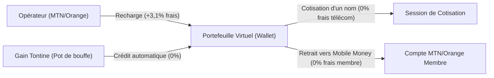
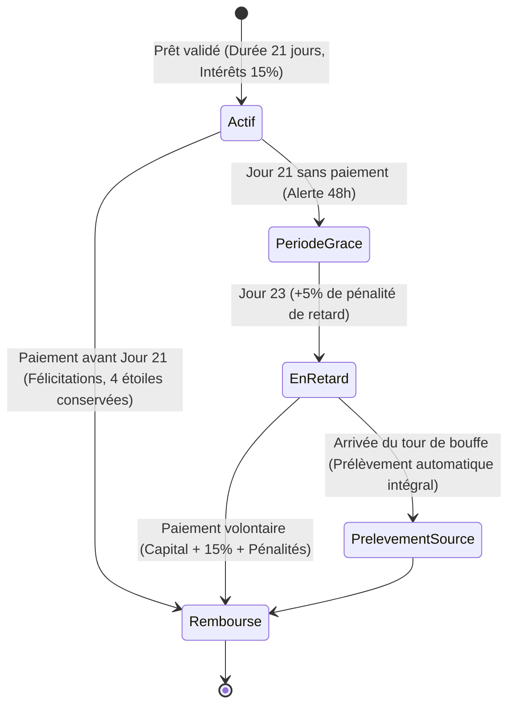
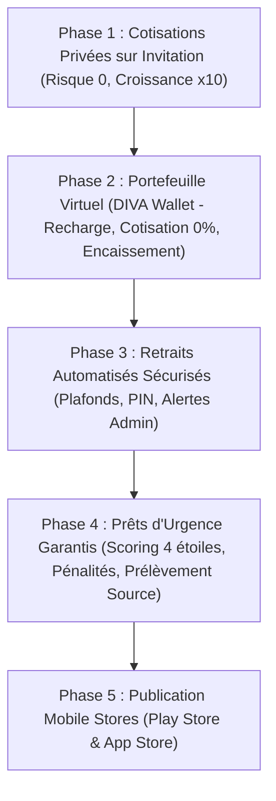

# Cahier des Charges Fonctionnel & Technique — DIVA Asso 🌿
## Évolutions Majeures : Portefeuille Virtuel, Prêts Garantis, Cotisations Privées & Déploiement Mobile

---

## 1. Présentation & Objectifs Généraux

Ce document constitue la référence officielle et contractuelle des futures fonctionnalités à intégrer sur la plateforme **DIVA Asso**. Il synthétise l'ensemble des règles de gestion, des calculs financiers, de l'architecture logicielle, des flux de sécurité anti-fraude et de la feuille de route de déploiement.

### Les 4 Grands Piliers d'Évolution :
1. **Portefeuille Virtuel Interne (DIVA Wallet) :** Recharge, encaissement du pot à l'échéance, cotisations sans commission opérateur (0 % de frais Fapshi sur solde interne), et retraits vers MTN / Orange Money.
2. **Système de Prêt d'Urgence Garanti :** Micro-crédit réservé aux membres émérites (4 étoiles), plafonné mathématiquement au collatéral restant (+10 000 FCFA de tolérance de risque), remboursable en 3 semaines à 15 % d'intérêts avec pénalités de retard et prélèvement à la source.
3. **Cotisations Privées sur Invitation :** Création autonome de tontines non publiques (cercles fermés, familles, collègues) avec liens d'invitation uniques WhatsApp.
4. **Déploiement Mobile & Sécurité :** Encapsulation PWA / Capacitor pour Google Play Store & Apple App Store, et protocoles stricts de sécurisation des retraits.

---

## 2. Pilier 1 — Le Portefeuille Virtuel (DIVA Wallet)

### 2.1. Principes Fondamentaux
Chaque membre dispose d'un portefeuille numérique virtuel rattaché à son compte utilisateur. Le portefeuille sépare la valeur monétaire interne des passerelles bancaires et évite de payer systématiquement les commissions des opérateurs télécoms (3,1 % MTN / Orange Money via Fapshi).



### 2.2. Flux et Règles Financières

| Opération | Frais & Commissions | Comportement Système |
| :--- | :--- | :--- |
| **Recharge du Portefeuille** | **Cotisation + 3,1 % Fapshi** | Le membre dépose des fonds via son numéro MTN ou Orange Money. Fapshi valide le webhook et crédite instantanément le solde net dans le portefeuille. |
| **Cotisation depuis le Portefeuille** | **0 % frais télécom** *(Seuls les frais associatifs habituels s'appliquent)* | Le membre sélectionne ses noms et clique sur « Payer via mon Portefeuille ». Le débit est instantané, sans passer par MTN/Orange Money et sans payer les 3,1 %. |
| **Encaissement du Pot (Bouffe)** | **Crédit automatique à 100 %** | Dès qu'un membre arrive à son tour de bouffe, le montant net de son pot est directement versé dans son portefeuille virtuel. |
| **Retrait vers Mobile Money** | **Sans frais pour le membre (0 %)** | Le membre saisit le montant à retirer et son numéro MTN/Orange Money. L'association prend en charge les frais de payout ou les amortit via les frais associatifs. |

### 2.3. Sécurité et Gestion de Trésorerie
- **Solde Non Négatif :** Un portefeuille ne peut jamais être débiteur (solde $\ge 0$).
- **Isolation des Transactions :** Chaque mouvement génère une écriture immuable dans une table `WalletTransaction` (horodatage, référence, solde avant, solde après, type d'opération).

---

## 3. Pilier 2 — Prêts d'Urgence Garantis & Scoring 4 Étoiles

Ce mécanisme permet d'offrir une caisse de secours aux membres tout en éliminant mathématiquement le risque de défaut de paiement pour l'association.

### 3.1. Conditions d'Éligibilité
Pour être autorisé à soumettre une demande de prêt, le membre doit obligatoirement remplir **les 3 conditions cumulatives suivantes** :

1. **Badge de Confiance 4 Étoiles :** 
   - Le membre doit avoir terminé au moins **un cycle complet de cotisation sans AUCUNE amende ni retard de paiement**.
   - Une seule amende ou retard actif rétrograde le score et bloque l'accès au prêt.
2. **Participation Active en Cotisation Publique :**
   - Le prêt est réservé aux membres des cotisations publiques gérées par DIVA Asso (les cotisations privées gèrent leur propre confiance).
3. **Collatéral Résiduel Disponible :**
   - Le membre **ne doit pas avoir déjà bouffé tous ses noms**. S'il a déjà perçu tous ses pots du cycle en cours, son éligibilité est égale à zéro.

### 3.2. Formule Mathématique du Plafond de Prêt

Le système calcule en temps réel le collatéral résiduel garanti du membre :

$$\text{Dette Restante } (D) = \sum \text{Cotisations futures dues sur les noms déjà bouffés}$$

$$\text{Gain Futur Garanti } (G) = \sum \text{Pots des noms restant à bouffer par le membre}$$

$$\text{Collatéral Net } (C_{\text{net}}) = G - D$$

Le montant maximal qu'un membre peut emprunter est défini par :

$$\text{Plafond Maximal} = \max(0, C_{\text{net}}) + 10\,000\text{ FCFA}$$

> **Tolérance de Risque Fixe de l'Association :** La marge de 10 000 FCFA est le risque maximal consenti par l'association sur ses membres 4 étoiles. Si le membre fait défaut complet, la perte pour la caisse ne peut mathématiquement jamais excéder 10 000 FCFA.

### 3.3. Taux d'Intérêt, Durée et Pénalités



- **Durée Contractuelle :** **3 semaines (21 jours calendaires)** avec horodatage précis et compte à rebours visible sur le tableau de bord du membre.
- **Intérêts Initiaux :** **15 %** du montant emprunté.
  - *Exemple :* Prêt de 50 000 FCFA $\rightarrow$ 7 500 FCFA d'intérêts $\rightarrow$ Total dû = 57 500 FCFA.
- **Période de Grâce :** **2 jours** après la fin des 21 jours.
- **Pénalités de Retard :** À partir du 23ᵉ jour, majoration automatique de **+5 %** du capital emprunté tous les 2 jours de retard supplémentaire.
- **Garantie Ultime (Prélèvement à la Source) :**
  - Si le prêt n'est toujours pas remboursé lorsque le tour de bouffe du nom restant arrive, l'application retient **automatiquement** :
    $$\text{Montant Prélèvement} = \text{Capital Emprunté} + \text{Intérêts (15\%)} + \text{Pénalités de retard}$$
  - Le membre perçoit le reste du pot, accompagné d'un reçu PDF officiel certifiant la déduction.

---

## 4. Pilier 3 — Cotisations Privées sur Invitation

Permettre à n'importe quel utilisateur ou groupe (familles, promotions, collègues de service, commerçants d'un marché) d'héberger sa propre tontine sur DIVA Asso en toute confidentialité.

### 4.1. Caractéristiques des Tontines Privées
- **Invisibilité Publique :** La cotisation n'apparaît sur aucun tableau de bord public. Seuls les membres invités peuvent la voir.
- **Lien Unique d'Invitation Sécurisé :**
  - Format : `https://divaasso.com/join/[token-securise]`
  - Partageable en 1 clic sur WhatsApp, SMS ou par e-mail.
- **Gestionnaire de Tontine (Créateur) :**
  - Fixe le montant unitaire de la mise, la fréquence (hebdomadaire, bimensuelle, mensuelle), le calendrier et l'ordre de passage.
  - Valide les demandes d'entrée des membres.
- **Règles d'Isolation :**
  - Les membres des cotisations privées ne sont pas éligibles aux prêts de la caisse publique de DIVA Asso (séparation stricte des risques).

---

## 5. Pilier 4 — Sécurité des Retraits Automatiques & Déploiement Mobile

### 5.1. Sécurité Anti-Piratage des Retraits Automatiques
Pour garantir qu'aucun pirate ne puisse vider la caisse même en cas de tentative d'intrusion :

1. **Vérification d'Identité du Numéro (KYC / Whitelist) :**
   - Le numéro MTN ou Orange Money recevant le virement doit correspondre au vrai nom vérifié du compte utilisateur.
   - Tout changement de numéro de téléphone requiert une confirmation par mot de passe et un délai de verrouillage de **48 heures** avant tout retrait.
2. **Code PIN / Validation Double Facteur (2FA) :**
   - Toute demande de retrait exige la saisie d'un code PIN à 4 chiffres défini par le membre ou d'un code OTP envoyé par WhatsApp/SMS.
3. **Plafonds Automatiques & Validation Admin :**
   - Retraits inférieurs à **50 000 FCFA** : virement automatique immédiat via l'API Fapshi Payout.
   - Retraits supérieurs à **50 000 FCFA** : alerte push à l'administrateur avec bouton « Approuver le virement ».
4. **Solde Tampon Fapshi Restreint :**
   - Ne jamais conserver plus que le volume nécessaire pour le cycle hebdomadaire sur le compte Fapshi Payout.

### 5.2. Déploiement sur Google Play Store & Apple App Store
* **Méthode Technique :** Wrapper PWA officiel via **Capacitor** ou **Bubblewrap / TWA** (aucun besoin de réécrire le code React/Next.js).
* **Google Play Store (Android) :**
  - Compte développeur personnel : 25 $ (environ 16 500 FCFA payé une fois à vie).
  - Validation via 20 testeurs mobilisés sur les groupes WhatsApp de la tontine pendant 14 jours.
* **Apple App Store (iOS) :**
  - Compte développeur Apple : 99 $/an (environ 63 000 FCFA/an).
  - Compilation automatisée dans le cloud via GitHub Actions (aucun Mac physique nécessaire).
  - Intégration du bouton obligatoire de suppression de compte et fourniture d'un compte de démonstration pour les vérificateurs d'Apple.

---

## 6. Schéma de Données Prévisionnel (Prisma)

Voici les structures de données prêtes à être intégrées dans le schéma de base de données :

```prisma
model Wallet {
  id             String              @id @default(cuid())
  userId         String              @unique
  user           User                @relation(fields: [userId], references: [id], onDelete: Cascade)
  balance        Int                 @default(0) // En FCFA
  pinCodeHash    String?
  createdAt      DateTime            @default(now())
  updatedAt      DateTime            @updatedAt
  transactions   WalletTransaction[]
}

model WalletTransaction {
  id             String              @id @default(cuid())
  walletId       String
  wallet         Wallet              @relation(fields: [walletId], references: [id], onDelete: Cascade)
  type           WalletTxType        // TOPUP, CONTRIBUTION_PAY, PAYOUT_RECEIVED, WITHDRAWAL, LOAN_DISBURSEMENT, LOAN_REPAYMENT
  amount         Int                 // Montant de la transaction
  balanceBefore  Int
  balanceAfter   Int
  reference      String?             @unique
  status         TxStatus            @default(COMPLETED) // PENDING, COMPLETED, FAILED
  metadata       Json?
  createdAt      DateTime            @default(now())
}

model Loan {
  id             String              @id @default(cuid())
  userId         String
  user           User                @relation(fields: [userId], references: [id])
  principal      Int                 // Montant emprunté (ex: 50 000)
  interestRate   Float               @default(0.15) // 15% initial
  interestAmount Int                 // ex: 7 500
  penaltyAmount  Int                 @default(0)    // Cumul des +5% en cas de retard
  totalDue       Int                 // Principal + Intérêts + Pénalités
  totalPaid      Int                 @default(0)
  status         LoanStatus          @default(ACTIVE) // ACTIVE, OVERDUE, REPAID, DEDUCTED_FROM_POT
  dueDate        DateTime            // loanDate + 21 jours
  lastPenaltyAt  DateTime?
  guaranteeSlotId String?            // Id du nom futur servant de garantie
  createdAt      DateTime            @default(now())
  updatedAt      DateTime            @updatedAt
}

enum WalletTxType {
  TOPUP
  CONTRIBUTION_PAY
  PAYOUT_RECEIVED
  WITHDRAWAL
  LOAN_DISBURSEMENT
  LOAN_REPAYMENT
}

enum LoanStatus {
  ACTIVE
  OVERDUE
  REPAID
  DEDUCTED_FROM_POT
}
```

---

## 7. Ordre d'Implémentation Recommandé



---
*Document certifié conforme aux spécifications arrêtées avec l'administrateur de DIVA Asso.*
